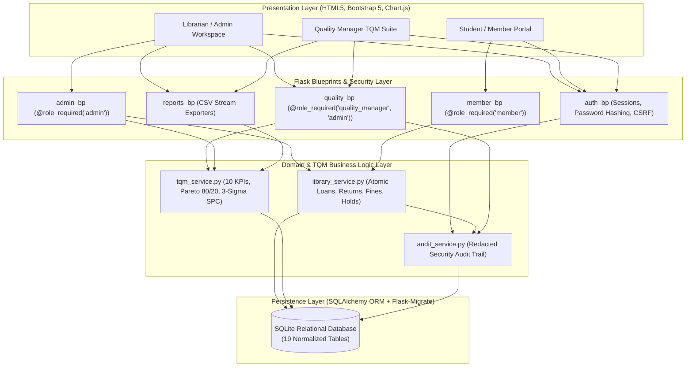
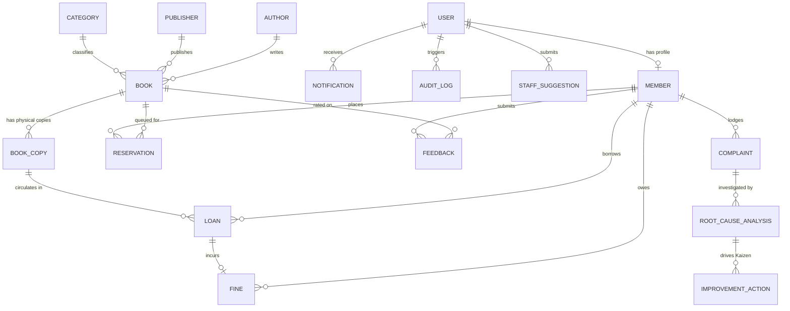
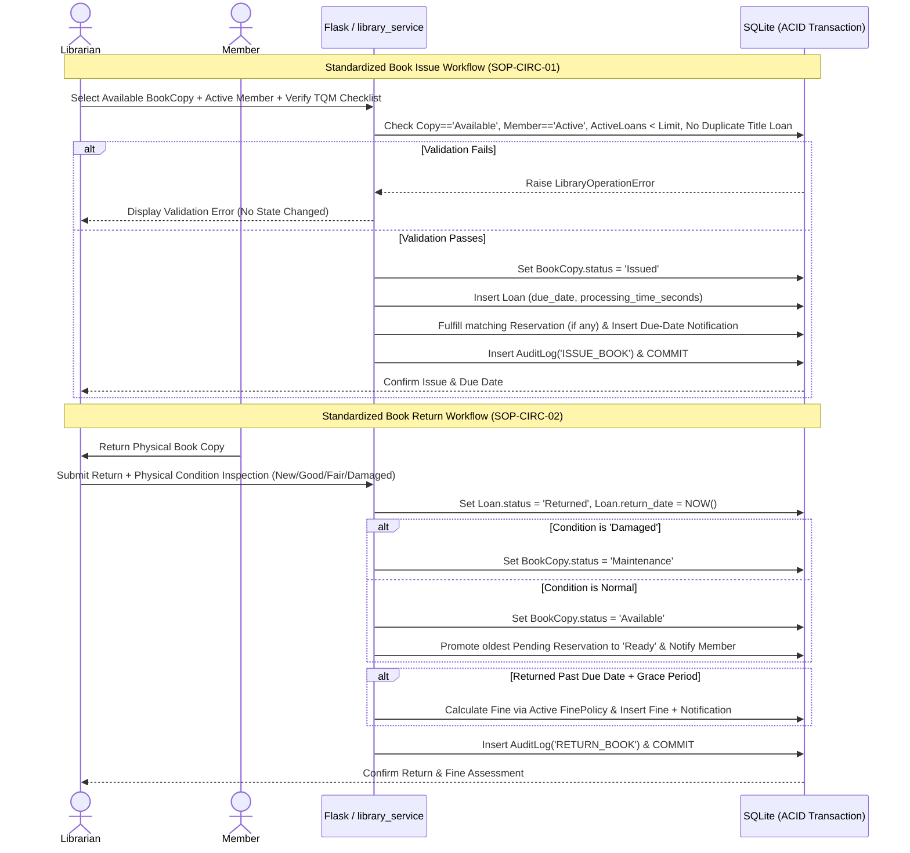

# System Architecture, Database ER Diagram, and Circulation Workflows

## 1. Layered System Architecture (Mermaid)

---

## 2. Relational Database Entity-Relationship Diagram (Mermaid)

---

## 3. Standardized Book Issue & Return Workflow Diagram (Mermaid)

